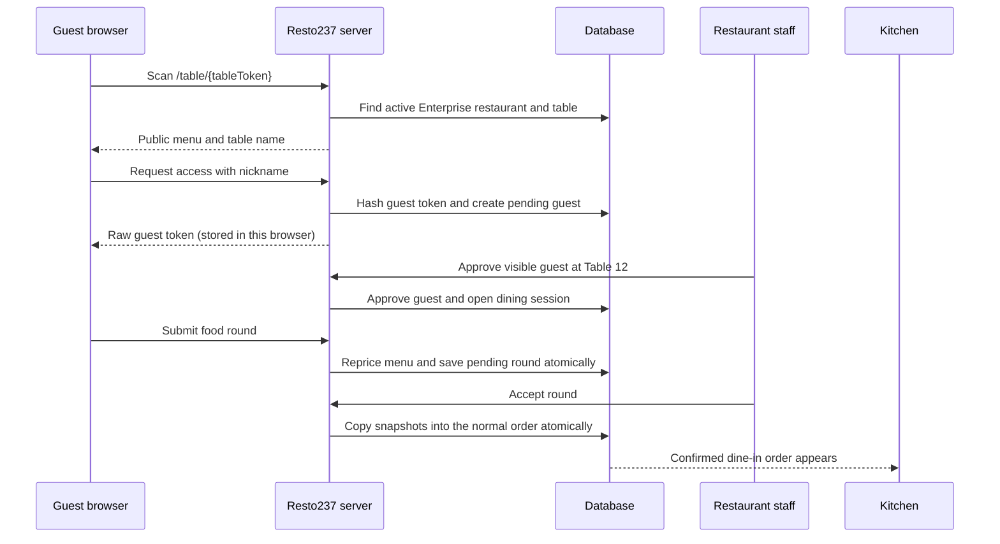
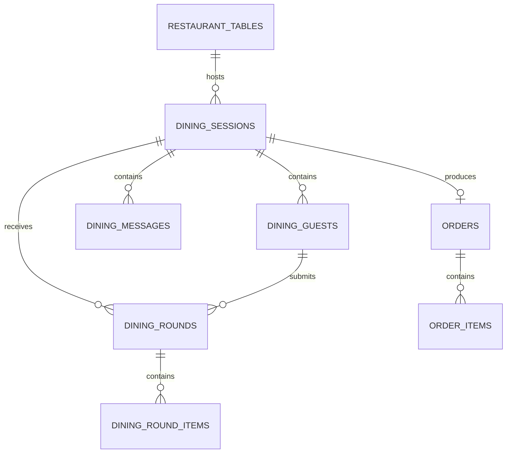
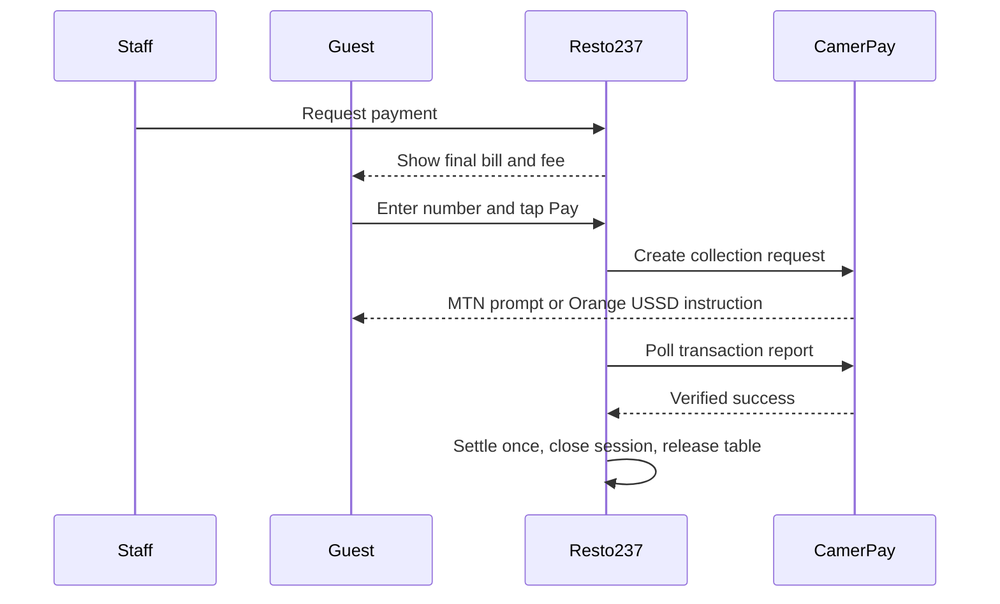

# Resto237 QR Table Service — Developer Handout

This guide explains the on-site dining feature in beginner-friendly language. Read it beside the code. You do not need to understand every database term on the first pass.

## 1. The problem we are solving

A printed QR code stays on a restaurant table. A guest scans it, orders without creating an account, asks a waiter for help, follows preparation, and pays at the end. The restaurant must know which physical table and browser sent every action.

The difficult part is identity. A permanent QR code can be photographed. Therefore, the QR code identifies a **table**, but it does not prove a person is sitting there. A staff member provides that proof by approving the browser requesting access.

## 2. Important terms

- **Table token:** A random UUID stored on `restaurant_tables.public_token`. It appears in the QR URL. It locates a table but grants no ordering permission.
- **Dining session:** One visit by one group at one table. It starts when staff approves a guest and ends after payment or cancellation.
- **Guest token:** A random 256-bit secret created for one browser. The browser stores the raw value. The database stores only its SHA-256 hash.
- **Hash:** A one-way fingerprint. We can compare a supplied token with its stored fingerprint without saving the original secret.
- **Guest request:** A browser waiting for a waiter to approve it.
- **Round:** A group of dishes submitted together. A round stays outside the kitchen order until staff accepts it.
- **Atomic operation:** A set of database changes that either all succeed or all fail. This prevents half-created orders.
- **Idempotency:** Repeating an operation does not charge or apply it twice.
- **Server action:** A function that runs on the server even when a React client component calls it.
- **RLS:** Supabase Row Level Security. Guest dining tables have RLS enabled and no public read policy, so browsers cannot query operational records directly.

## 3. High-level flow

## 4. Why the guest does not need an account

The guest token acts as a temporary identity for this visit. It is narrower than an account:

- It works for one dining session only.
- It cannot access wallets, old orders or profile information.
- It expires when the restaurant closes the table.
- Staff can reject it before it becomes active.

The token is kept in browser `localStorage` so refreshing the page does not lose the visit. Every sensitive server action receives the token, hashes it, and looks for an approved guest with the same hash.

A customer who wants to use a Resto237 wallet still needs to sign in because wallet ownership cannot safely be anonymous.

## 5. Why staff approval matters

The static QR code can be photographed. GPS is imprecise indoors, and requiring restaurant Wi-Fi would exclude customers using mobile data. Staff approval is a simple physical-presence check:

1. The dashboard says “Emmanuel requests access to Table 12.”
2. The waiter looks at Table 12.
3. The waiter approves only if someone there has just scanned.

The remote person can see the public menu, but cannot order or message staff. Approval is not perfect if a real diner deliberately helps an attacker, but it blocks ordinary reuse of an old QR photograph.

## 6. Database model

`dining_round_items` and `order_items` contain snapshots of names and prices. If a manager changes a dish tomorrow, yesterday’s bill stays correct.

Only one active dining session is allowed per table. A partial unique database index enforces this even if two phones scan at the same millisecond.

## 7. Atomicity

Several PostgreSQL functions contain the important multi-row work:

- `decide_dining_guest(...)` approves a browser, opens the visit and occupies the physical table together.
- `submit_dining_round(...)` validates the guest, checks the open session, reads current menu prices and writes the round plus its items together.
- `accept_dining_round(...)` verifies staff membership, creates or updates the normal dine-in order, copies accepted items, updates the table and records history together.
- `request_dining_payment(...)` adds the configured online fee and moves both the order and dining session into payment together.
- `close_dining_cash(...)` and `settle_online_order_payment(...)` close the bill, expire guest tokens and release the table together.

If inserting the third dish fails, PostgreSQL rolls back the whole function. The kitchen never receives an empty order header or half a round.

The client never sends authoritative prices. It sends menu item IDs, quantities and option IDs. PostgreSQL reads the real prices again.

## 8. Messages and quick requests

A dining message always carries `session_id` and usually `guest_id`. Staff therefore see the table and guest without seeing a phone number.

Quick actions such as “Water” are structured message kinds. Structured kinds are useful for notifications, translations and future analytics. A normal typed message uses the `message` kind.

The first version polls for updates every five seconds. Polling is simple and reliable. Supabase Realtime can replace it later when the feature is stable.

## 9. Ordering and kitchen safety

Guest submissions first enter `dining_rounds` as `pending`. They are not inserted into `order_items` yet, so the kitchen cannot accidentally cook an unapproved request.

When staff accept a round, its items join one normal dine-in order for that table session. This lets the existing order queue, kitchen display, receipts and reporting continue to work.

Additional accepted rounds increase the same open bill. Rejected rounds remain visible to the guest but never enter the kitchen order.

## 10. End-of-service payment

The default is payment after service.

### Cash

An authorized owner or manager records the cash payment. `close_dining_cash(...)` marks the order paid, creates a payment receipt, closes the dining session, expires guest tokens and releases the table atomically.

### Mobile Money

Staff send a payment request; they do not debit the customer. The order receives the configured online service fee and moves to `awaiting_customer`. The guest reviews the total, enters their own number and launches CamerPay.

CamerPay’s callback is treated as a hint. Resto237 checks CamerPay’s own report before settlement. Existing compare-and-swap and ledger rules prevent double settlement.

## 11. Package boundary

Guest QR ordering is available only when the branch has an active or grace-period **Enterprise (25,000 FCFA)** subscription. The ordinary staff-entered table-order screen remains available under its existing paid-plan rules.

The public landing query rechecks the package. Hiding a button in the dashboard is never treated as authorization.

## 12. Main files

- `supabase/migrations/0054_guest_table_service.sql` — schema and atomic database functions.
- `src/lib/data/dining-actions.ts` — guest and staff server actions.
- `src/app/(table)/table/[token]/page.tsx` — anonymous QR landing page.
- `src/app/(table)/table/[token]/guest-table-client.tsx` — mobile guest experience.
- `src/app/(manager)/m/table-order/dining-floor.tsx` — approvals, messages and payments.
- `src/app/api/table-qr/[token]/route.ts` — self-hosted SVG QR generation.
- `src/app/(manager)/m/tables/print/page.tsx` — printable bilingual table cards.

## 13. Security checklist

When extending this feature, ask:

1. Is the restaurant ID derived from a verified table/session or staff session?
2. Does the server re-read prices instead of trusting the browser?
3. Does the action require an approved, unexpired guest token?
4. Is a staff capability checked again inside the server action?
5. Can two simultaneous requests create duplicate sessions or payments?
6. Will failure leave half-written rows?
7. Does closing a table revoke every guest token?
8. Are phone numbers and raw guest tokens absent from logs?

## 14. Exercises for learning

1. Draw the state transitions for `dining_sessions`, `dining_guests` and `dining_rounds` separately.
2. Explain why the table QR token and guest token are different secrets.
3. Try to identify which validation belongs in the UI and which must be repeated on the server.
4. Add a `napkins` quick-request kind through the migration, action and button.
5. Replace five-second polling with Supabase Realtime while preserving RLS.
6. Write a concurrency test where two guests request the same unused table simultaneously.

The central lesson is that interface state is not authorization. The browser helps the user understand what can happen; the server and database decide what is allowed to happen.
